# StudyPals – Campus Study Group & Library Finder

## Project Overview
StudyPals is a Flutter-based mobile application designed to help university students find study groups, check library seat availability, communicate with group members, and reserve library time slots.

The project is being developed as part of the Zynvex Solutions Batch 5 Virtual Internship.

## Technologies Used
- Flutter
- Dart
- Hive CE (local database)
- Git and GitHub
- Visual Studio Code

## Module 1: Project Setup and Planning

**Duration:** October 26 – November 1, 2026

### Completed Work
- Created the Flutter project named StudyPals.
- Configured and ran the application successfully in Chrome.
- Created a GitHub repository for project version control.
- Implemented the initial four-tab navigation structure:
  - Groups
  - Library
  - Chat
  - Profile
- Created the initial screens for the four main sections.
- Designed the database structure and documented it in `docs/database_design.md`.

### Application Navigation
The application contains four main sections:

1. **Groups:** Students will be able to discover and create study groups.
2. **Library:** Students will be able to check available library seats.
3. **Chat:** Students will be able to view their group conversations.
4. **Profile:** Students will be able to view their student profile and badges.

### Database Planning
The planned database structure includes:
- Users
- Groups
- Library Tables
- Reservations

### Project Repository
GitHub: https://github.com/alishaa876/StudyPals

## Module 2: Development – In Progress

The next development phase focuses on:
- Study group creation and management.
- Subject tags and search filters.
- Local database storage.
- Displaying and managing study groups.

## Future Development
The upcoming modules will focus on:
- Library seat availability.
- Time-slot reservations.
- Group chat lists.
- Student profile badges.
- Data validation and application testing.
- Final APK build and project documentation.

## Module 1 – Application Screenshot

This screenshot shows the initial working StudyPals application with four-tab navigation.

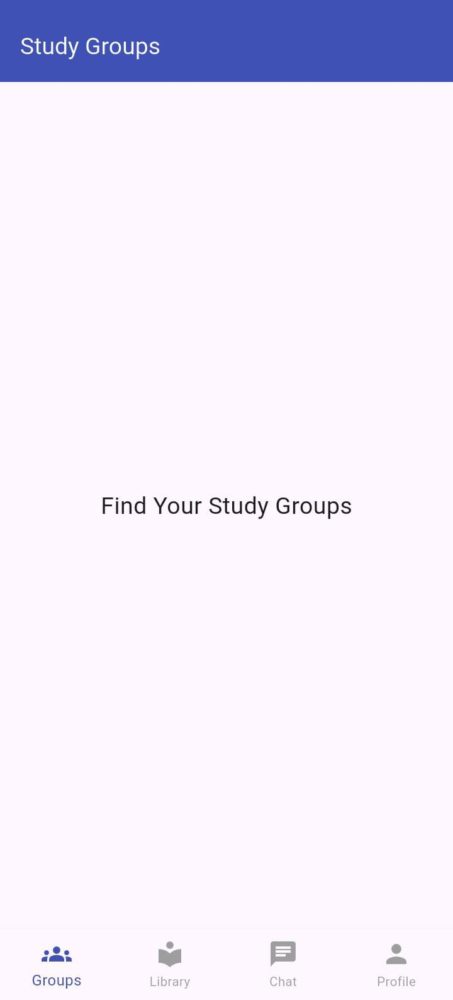

## Module 2: Study Group Development and Local Database

**Duration:** November 02 – November 08, 2026

### Completed Work

- Implemented the study group creation form.
- Added subject tags for study groups.
- Implemented the study group listing screen.
- Added CRUD operations (Create, Read, Update, Delete) for managing study groups.
- Created a simple user profile screen.
- Integrated Hive CE for local database storage.
- Implemented saving and loading of application data using the local database.

### Module 2 – Key Features

1. **Create Groups:** Users can create new study groups.
2. **View Groups:** Users can view available study groups.
3. **Edit Groups:** Users can update existing study group information.
4. **Delete Groups:** Users can remove study groups.
5. **User Profile:** A basic profile screen is available.
6. **Local Database:** Study group data is stored and retrieved using Hive CE.

### Module 2 – Application Screenshots

Module 2 screenshots will be added below to demonstrate the completed implementation.

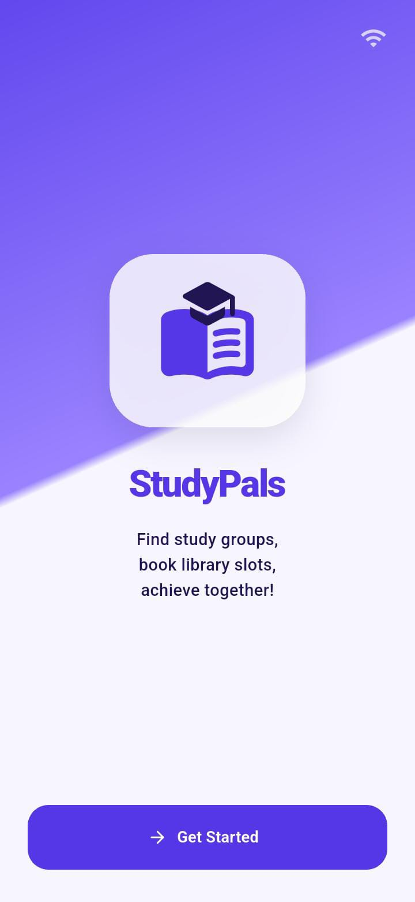
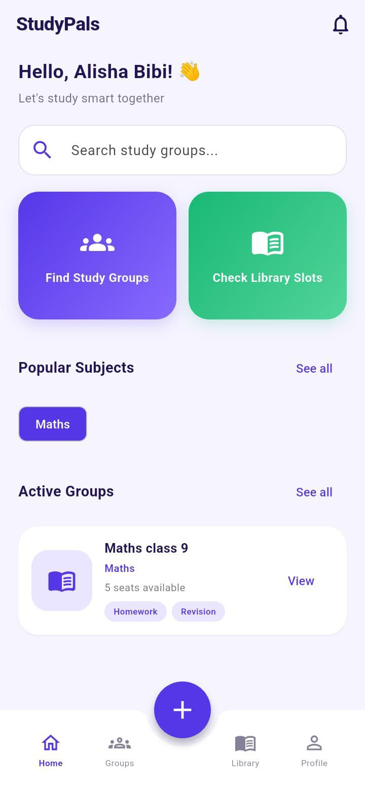
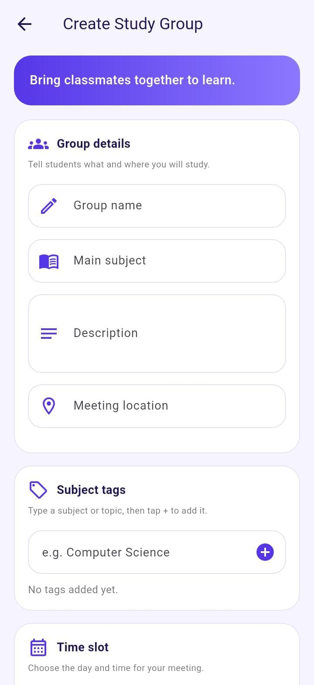
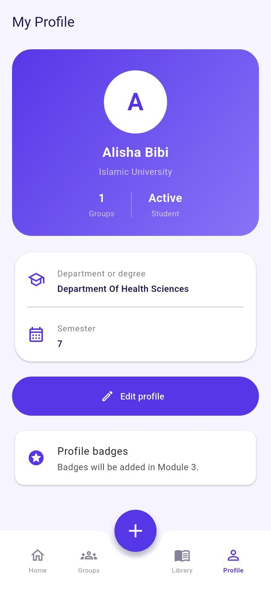
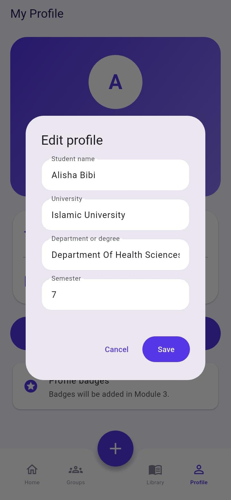

## Module 3: Library Booking, Search and User Interaction

**Duration:** November 09 – November 15, 2026

### Completed Work

- Built the library seat availability screen.
- Implemented time-slot booking functionality.
- Added search functionality for study groups.
- Implemented filter pickers for subject and time.
- Created a basic group chat list.
- Added a simple profile badge.
- Implemented form validation.

### Module 3 – Key Features

1. **Library Seat Availability:** Users can view available library seats.
2. **Time-Slot Booking:** Users can select and book library time slots.
3. **Search:** Users can search for study groups.
4. **Subject and Time Filters:** Users can filter study groups by subject and time.
5. **Group Chat List:** Users can view their group conversations.
6. **Profile Badge:** Users can view their profile badge.
7. **Form Validation:** Input fields are validated to prevent invalid submissions.
8. **Loading Indicators:** Loading feedback is displayed during relevant operations.

### Module 3 – Application Screenshots

Module 3 screenshots will be added below to demonstrate the completed implementation.

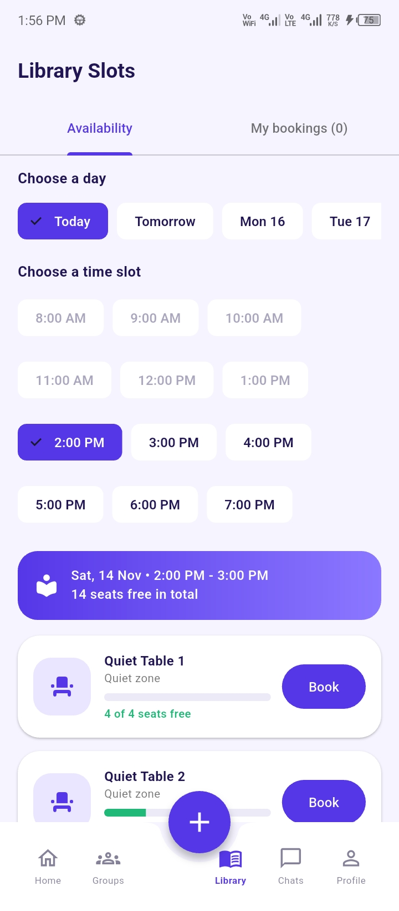
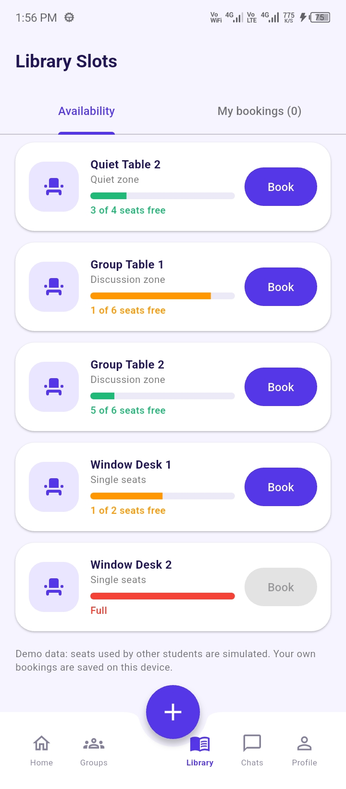
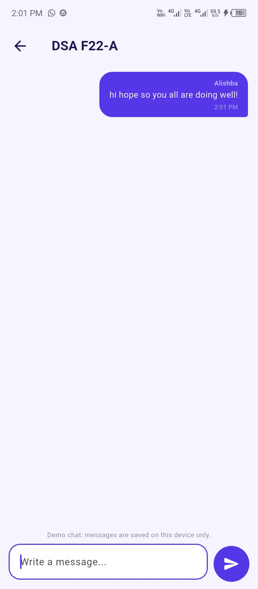
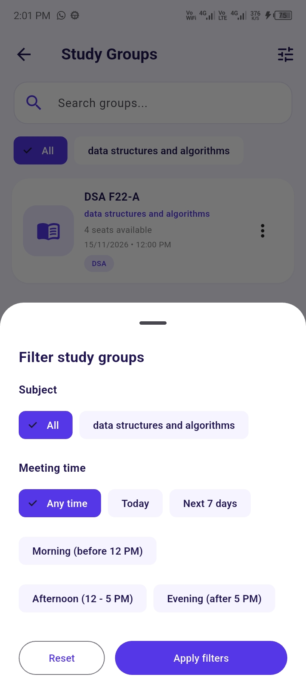
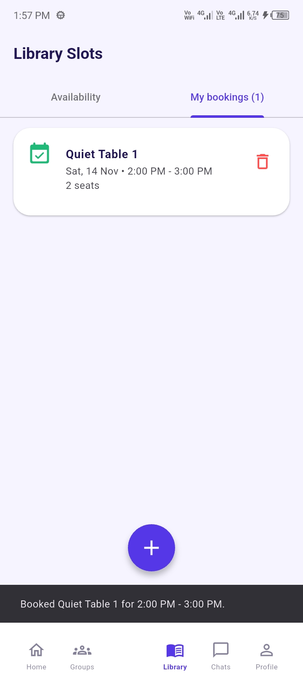
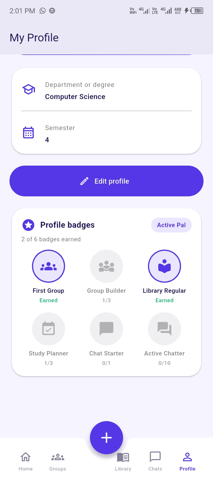

## Project Status
Module 1: Progress completed.
Module 2 : Progress completed.
Module 3: Progress Completed.